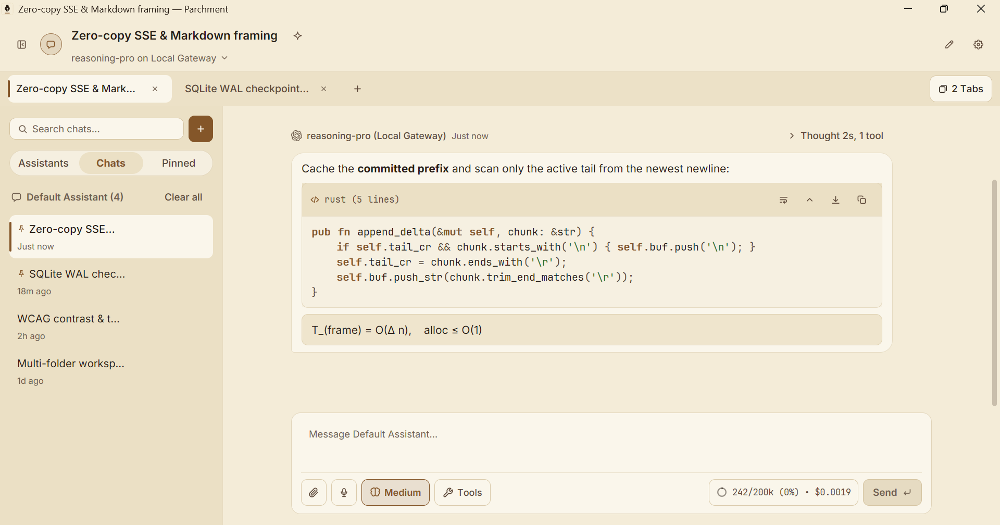
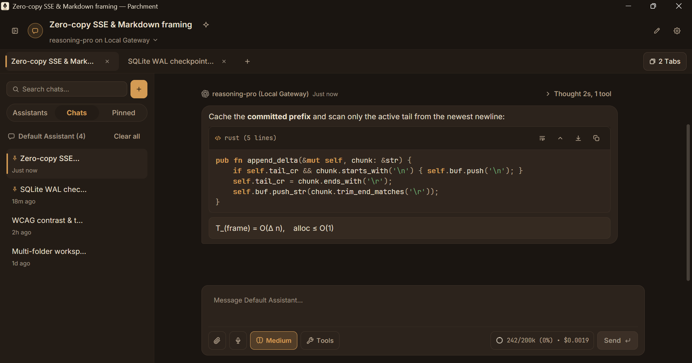
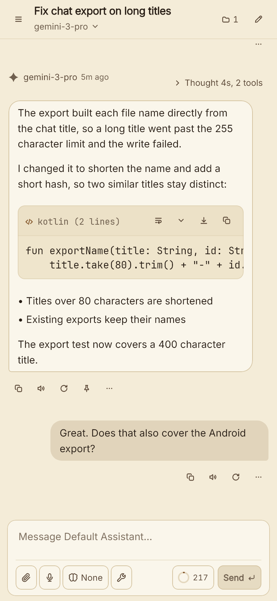

# YL Axiom

A native AI software-engineering app for Windows and Android. Bring your own provider and key; YL Axiom talks to it directly, keeps your chats on your device, and asks before any tool touches your files, the web or your screen.

Built with a native Rust core (SQLite WAL + FTS5), a native Windows GPUI desktop shell, and Jetpack Compose Foundation on Android: no Electron, no WebView, no Material.

  

**Download:** [Windows installer (`.exe`)](https://github.com/ylstack1/yl-axiom/releases/latest/download/YL-Axiom-Windows-x64-Setup.exe) · [Android (`.apk`)](https://github.com/ylstack1/yl-axiom/releases/latest/download/YL-Axiom-Android-Universal.apk)

  
  

## What it does

**Chat and writing**
- Messenger bubbles or a single continuous page, with Markdown, code, LaTeX and SVG rendering.
- Attach images, PDFs, audio, video and code by picking, pasting or dropping files.
- Reasoning, tool steps and text stay in the order they happened.
- Branches, versions, rewind, story summaries, author notes and full-history search.
- Pin replies and find them again in the sidebar, for one chat or all of them.
- Character cards (V2/V3, PNG or JSON) and a World Book whose entries trigger on keywords.
- Read aloud, dictation, and `/` commands such as `/goal`, `/compact` and `/continue`.
- Composer controls for thinking effort and, for image and video models, aspect ratio, resolution and duration, with custom values.
- Separate text and code fonts, including your own .ttf or .otf, and a native Windows 11 title bar.
- Keyboard shortcuts: Ctrl+K command palette, Ctrl+G jump to one of the chat's prompts, Ctrl+N new chat, Ctrl+W close tab, Ctrl+Tab next tab, Ctrl+, settings, Ctrl+B sidebar.

**Providers**
- OpenAI Responses and Chat Completions, Anthropic Messages, and Gemini Interactions and generateContent, plus any compatible service through a custom provider.
- Multiple API keys per provider with round-robin selection and automatic failover on rate limits or auth errors.
- Models and their limits come from the provider and public registries; no model names are hardcoded.
- Recovers from dropped streams, empty answers and context overflow without losing reasoning or tool results; interrupted runs and accepted video jobs resume on Continue.
- Per-request token and cost records, with an optional spend limit per chat.

**Agent tools**
- File tools across one or more folders you choose, keyless web search and fetch, a calculator, a todo list and goals.
- Ask-the-user questions, read-only helper agents (several work side by side), and on-demand skills you can install from a GitHub link.
- Runs of file reads and searches fold into one quiet row; compound shell commands are broken down step by step before you approve them.
- MCP servers, browsable from the official registry.
- Computer control on Windows and phone control on Android, both off by default.
- Every action can require approval. Imported chats never bring tool access with them.

**Everyday reliability**
- Atomic saves with backups, so a crash never leaves a half-written chat.
- Long runs keep going while the app is in the background, within what the system allows.
- Built for low-end hardware: a standalone native Windows `.exe` and a lean Android APK with a shared Rust SQLite WAL + FTS5 core, plus a lighter mode on low-memory devices; see [measured budgets and benchmarks](docs/performance.md).
- In-app updates check size and SHA-256 before installing.
## Privacy

There are no accounts, analytics or telemetry. Your chats, settings and keys stay on your device. YL Axiom connects to:

- **Your providers**, with your keys, when you send a message or list models.
- **Public model catalogs** (models.dev, OpenRouter, Vercel AI Gateway, AI/ML API and LiteLLM) when a model's limits or prices are unknown. No key or chat content is sent.
- **GitHub**, for the update check in release builds (it can be turned off), AI lab logos, and skills you install from a link.
- **The MCP registry** while you search it in Settings, and the **MCP servers** you add.
- **Web search and pages** (DuckDuckGo, Wikipedia, Hacker News search or a page the model fetches) only when web tools are on and you allow the call.

## Build from source

Run `cargo xtask status` (or `cargo xtask affected`) to verify both the Rust desktop and Kotlin Android targets; install local pre-commit checks once with `cargo xtask install-hooks`. [CONTRIBUTING.md](.github/CONTRIBUTING.md) covers toolchain setup and every command. Android releases require a private signing key outside the repository; see [release signing](docs/release-signing.md).

## Documentation

| Read | For |
|---|---|
| [.github/CONTRIBUTING.md](.github/CONTRIBUTING.md) | Principles, setup, build commands and how to submit a change |
| [AGENTS.md](AGENTS.md) | Working rules, engineering rigor and stable contracts for people and AI agents |
| [docs/architecture.md](docs/architecture.md) | How the code is laid out and where to change what |
| [docs/design.md](docs/design.md) | The visual design, tokens, icons and wording |
| [docs/performance.md](docs/performance.md) | Speed, memory and size budgets, and how to measure them |
| [docs/release-signing.md](docs/release-signing.md) | Private release keystore setup and CI signing secrets |
| [docs/third-party-notices.md](docs/third-party-notices.md) | Third-party font and library licence notices |
| [TODO.md](TODO.md) | Current status, open work and known gaps |
| [.memory/](.memory/) | YL Axiom engineering knowledge base: vision, architecture, audit, decisions, roadmap, tasks, risks |

## Acknowledgements

**Ideas we learned from**
- [Claude Code](https://github.com/anthropics/claude-code) and [OpenAI Codex](https://github.com/openai/codex): goals, todo checklists, compaction, steering a running reply, ask-the-user questions, helper agents and per-action approvals.
- [Oh-My-Pi](https://github.com/can1357/oh-my-pi): long-running agent loops and patient retries.
- [Kelivo](https://github.com/chevey339/kelivo): settings structure, task-specific default models and usage accounting.
- [iA Writer](https://ia.net/writer) and [Craft](https://www.craft.do/): the reading-first page.
- [aacode-rs](https://github.com/kandada/aacode-rs): tool-profile and context-compaction ideas (concepts only; GPL-3.0, no code reused).
- [fastshell](https://github.com/kandada/fastshell): optional Apache-2.0 Android shell runtime backend (feature-gated, not in default builds).

**Formats and standards**
- [Model Context Protocol](https://modelcontextprotocol.io/) and its [official registry](https://registry.modelcontextprotocol.io/): MCP servers and the server browser.
- [Agent Skills](https://agentskills.io/): the `SKILL.md` format for on-demand skills, installable from a GitHub link.
- [SillyTavern](https://github.com/SillyTavern/SillyTavern): character card (V2/V3) and lorebook compatibility.
- [tiktoken](https://github.com/openai/tiktoken): the `o200k_base` pattern behind the local token counter.

**Data**
- [models.dev](https://models.dev/), [OpenRouter](https://openrouter.ai/), [Vercel AI Gateway](https://vercel.com/docs/ai-gateway), [AI/ML API](https://aimlapi.com/) and [LiteLLM](https://github.com/BerriAI/litellm): model limits, modalities and pricing.
- [DuckDuckGo](https://duckduckgo.com/), [Wikipedia](https://www.wikipedia.org/) and [Hacker News Search](https://hn.algolia.com/): keyless web search.
- [LobeHub Icons](https://github.com/lobehub/lobe-icons): AI lab logos.

**Built with**
- [Rust](https://www.rust-lang.org/), [GPUI](https://www.gpui.rs/), [SQLite](https://www.sqlite.org/) (WAL + FTS5), [Kotlin Multiplatform](https://kotlinlang.org/docs/multiplatform.html), [Compose Multiplatform](https://www.jetbrains.com/compose-multiplatform/), [Ktor](https://ktor.io/) and [kotlinx.coroutines](https://github.com/Kotlin/kotlinx.coroutines) / [kotlinx.serialization](https://github.com/Kotlin/kotlinx.serialization).

## License

[MIT](LICENSE).
